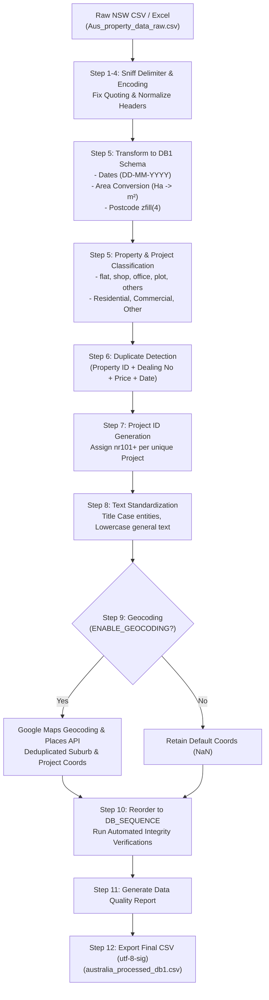

# Australia Property Sales Data Processing Pipeline

## NSW Land Registry $\rightarrow$ DB1 Standard Schema (74 Columns)

A unified, production-grade data processing pipeline for Australian property sales transactions (New South Wales Valuer General Land Registry records).

This standalone pipeline consolidates and streamlines the previous multi-step workflow (`australia_pipeline_db_new.ipynb` and `col_rename.ipynb`) into a single, reliable Jupyter Notebook:
- **Notebook**: [`australia_property_pipeline_standalone.ipynb`](australia_property_pipeline_standalone.ipynb)

---

## Table of Contents
1. [Overview & Architecture](#overview--architecture)
2. [What Was Consolidated & Fixed](#what-was-consolidated--fixed)
3. [Target Database Schema (74 Columns)](#target-database-schema-74-columns)
4. [The 8 Protected Audit Columns](#the-8-protected-audit-columns)
5. [Key Pipeline Logic & Business Rules](#key-pipeline-logic--business-rules)
   - [File Sniffing & Ingestion](#1-file-sniffing--ingestion)
   - [Area Conversion](#2-area-conversion)
   - [Date & Chronology Parsing](#3-date--chronology-parsing)
   - [Domain Classification (Property & Project Types)](#4-domain-classification-property--project-types)
   - [Duplicate Detection](#5-duplicate-detection)
   - [Project ID Generation (`index`)](#6-project-id-generation-index)
   - [Text Standardization & Title Casing](#7-text-standardization--title-casing)
   - [Geocoding (Google Maps API)](#8-geocoding-google-maps-api)
   - [Automated Verification & Export](#9-automated-verification--export)
6. [Prerequisites & Installation](#prerequisites--installation)
7. [Configuration Parameters](#configuration-parameters)
8. [How to Run](#how-to-run)
   - [Interactive Execution (Jupyter / IDE)](#option-a-interactive-execution)
   - [Command-Line / Headless Execution](#option-b-command-line--headless-execution)
9. [Troubleshooting & FAQ](#troubleshooting--faq)

---

## Overview & Architecture

Raw property sales datasets provided by the NSW Valuer General contain 1M+ rows of property records. This pipeline automates the ingestion, parsing, transformation, deduplication, entity indexing, and validation of raw sales records into the standardized company **DB1 sequence** (74 columns).



---

## What Was Consolidated & Fixed

| Feature / Issue | Previous Multi-Notebook Workflow | New Standalone Pipeline (`australia_property_pipeline_standalone.ipynb`) |
| :--- | :--- | :--- |
| **Workflow Friction** | Required running `australia_pipeline_db_new.ipynb` $\rightarrow$ saving `processed.csv` $\rightarrow$ running `col_rename.ipynb` across 30+ interactive cells $\rightarrow$ re-reading `processed_v1.csv` $\rightarrow$ `processed_v2.csv` $\rightarrow$ `processed_v3.csv`. | **Single, continuous execution** from raw input to final production-ready output with zero intermediate file hops. |
| **Date Parsing Bug** | Raw Australian dates are day-first (`DD-MM-YYYY` or `DD/MM/YYYY`). Older parsers attempted `%Y-%m-%d`, resulting in silent date corruption (`NaT`). | Robust day-first date parser iteratively trying `%d-%m-%Y`, `%d/%m/%Y`, `%Y-%m-%d`, and ISO formats. |
| **Area Calculation** | Hectare (H) conversion was split across files. | Vectorized conversion: Hectares ($H, HA, HECTARE$) $\times 10,000$, Square Metres ($M, M2, SQM$) as-is, fallback to `Area (m2)`. Outputs to `net_carpet_area_sq_m`. |
| **Property Categorisation** | Simplistic keyword matching in first notebook; manually updated in later notebook. | Unified domain categorisation classifier using comprehensive lookup sets (`FLAT_VALUES`, `SHOP_VALUES`, `OFFICE_VALUES`, `plot`, `others`). |
| **Project Type Mapping** | Ambiguous mappings between notebooks. | Clean derivation from `Primary purpose (normalised)` (`Residence` $\rightarrow$ `Residential`, `Commercial` $\rightarrow$ `Commercial`, others $\rightarrow$ `Other`) with fallback to raw purpose keywords. |
| **Project ID (`index`)** | Inconsistent: one notebook populated Property ID; the other cleared it and generated `nr101` IDs in a trailing cell. | Integrated sequential project ID generator: builds persistent `nr101+` IDs grouped by `(location_name, project_name)` for all valid projects. |
| **Column Names & Order** | Inconsistent legacy names (`document_no`, `net_carpet_area_sqmt`, `cost`, `time`). | Directly generates target names and aligns strictly with the 74-column `DB_SEQUENCE`. |
| **Protected Columns** | Manual checks at the end of `col_rename.ipynb`. | Built-in automated assertion check that halts execution if any protected column is modified. |
| **Geocoding Safety** | Geocoding cells could hang or exhaust Google API quotas when run on 1.2M rows. | Safe toggle `ENABLE_GEOCODING = False` by default; deduplicated unique locality and project lookups with rate-limiting when activated. |

---

## Target Database Schema (74 Columns)

The output file strictly conforms to the company's 74-column sequence:

| Col # | Column Name | Data Type | Source / Logic |
| :---: | :--- | :--- | :--- |
| **1** | `index` | string | Sequential project ID (`nr101`, `nr102`...) for named projects; `NA` for individual lots |
| **2** | `project_name` | string | Property name (Title Cased) |
| **3** | `village_name_marathi` | string | Reserved (`NA`) |
| **4** | `location_name` | string | Property locality / suburb (Title Cased) |
| **5** | `registered_document_village_name` | string | Reserved (`NA`) |
| **6** | `year` | Int64 | Settlement date year (e.g. `2020`) |
| **7** | `quarter` | string | Settlement date quarter (e.g. `Q1-2020`) |
| **8** | `city_name` | string | Standardized city/region constant (`New South Wales`) |
| **9** | `sub_registrar_office_code` | string | Reserved (`NA`) |
| **10** | `sub_registrar_office_name` | string | Reserved (`NA`) |
| **11** | `document_number` | string | NSW Land Registry Dealing number |
| **12** | `transaction_type` | string | Reserved (`NA`) |
| **13** | `agreement_price` | float64 | Purchase price (AUD) |
| **14** | `guideline_value` | float64 | Market valuation if provided (`NA` if absent) |
| **15** | `property_description` | string | Property legal description |
| **16** | `transaction_date` | datetime64 | Settlement date (`YYYY-MM-DD`) |
| **17** | `floor_number` | string | Reserved (`NA`) |
| **18** | `unit_number` | string | Cleaned unit number (float artifacts removed) |
| **19** | `property_type_raw` | string | Raw Primary purpose description |
| **20** | `net_carpet_area_sq_m` | float64 | Derived carpet area in square metres |
| **21** | `balcony_sq_m` | float64 | Reserved (`NA`) |
| **22** | `terrace_sq_m` | float64 | Reserved (`NA`) |
| **23** | `seller_name` | string | Reserved (`NA`) |
| **24** | `buyer_name` | string | Reserved (`NA`) |
| **25** | `transaction_category` | string | Transaction type (`sale`) |
| **26** | `internal_document_number` | string | Reserved (`NA`) |
| **27** | `micr_number` | string | Reserved (`NA`) |
| **28** | `bank_type` | string | Reserved (`NA`) |
| **29** | `party_code` | string | Reserved (`NA`) |
| **30** | `date_of_agreement_execution` | datetime64 | Reserved (`NA`) |
| **31** | `stamp_duty_paid` | float64 | Reserved (`NA`) |
| **32** | `registration_fee` | float64 | Reserved (`NA`) |
| **33** | `project_latitude` | float64 | Numeric GPS latitude of project (optional Google geocoding) |
| **34** | `project_longitude` | float64 | Numeric GPS longitude of project (optional Google geocoding) |
| **35** | `location_latitude` | float64 | Numeric GPS latitude of locality/suburb (optional Google geocoding) |
| **36** | `location_longitude` | float64 | Numeric GPS longitude of locality/suburb (optional Google geocoding) |
| **37** | `property_type` | string | Categorised type: `flat`, `shop`, `office`, `plot`, `others` |
| **38** | `unit_configuration` | string | Reserved (`NA`) |
| **39** | `buyer_pincode` | string | Reserved (`NA`) |
| **40** | `buyer_locality` | string | Reserved (`NA`) |
| **41** | `buyer_district` | string | Reserved (`NA`) |
| **42** | `buyer_state` | string | Reserved (`NA`) |
| **43** | `is_llm_processed` | string | Flag (`no`) |
| **44** | `is_manual_processed` | string | Flag (`no`) |
| **45** | `tower_name` | string | Reserved (`NA`) |
| **46** | `is_duplicate` | string | Duplicate status (`no` or `yes`) |
| **47** | `sale_type` | string | Reserved (`NA`) |
| **48** | `project_type` | string | Normalized type: `Residential`, `Commercial`, `Other` |
| **49** | `country_name` | string | Standardized country (`Australia`) |
| **50** | `state_name` | string | Standardized state (`New South Wales`) |
| **51** | `micro_market` | string | Reserved (`NA`) |
| **52** | `data_source` | string | Source identifier (`nsw`) |
| **53** | `sub_locality` | string | Property street name (Title Cased) |
| **54** | `pincode` | string | Property postcode zero-padded to 4 digits (e.g. `2000`) |
| **55** | `parking_count` | Int64 | Reserved (`NA`) |
| **56** | `facing_direction` | string | Reserved (`NA`) |
| **57** | `view_type` | string | Reserved (`NA`) |
| **58** | `furnishing_status` | string | Reserved (`NA`) |
| **59** | `condition_status` | string | Reserved (`NA`) |
| **60** | `source_accessibility` | string | Accessibility rating (`Easy`) |
| **61** | `source_accessibility_way` | string | Acquisition method (`Download`) |
| **62** | `sourcing_cost` | float64 | Reserved (`NA`) |
| **63** | `sourcing_time` | float64 | Reserved (`NA`) |
| **64** | `data_type` | string | Reserved (`NA`) |
| **65** | `normalized_unit_configuration` | string | Reserved (`NA`) |
| **66** | `project_stage` | string | Reserved (`NA`) |
| **67** | `Area (m2)` | string / numeric | **Protected Audit Column**: Original area in m² |
| **68** | `Area (source)` | string / numeric | **Protected Audit Column**: Original source area value |
| **69** | `Area type (source)` | string | **Protected Audit Column**: Original area unit (`H`, `M`, etc.) |
| **70** | `Nature of property (description)` | string | **Protected Audit Column**: Original property description |
| **71** | `Primary purpose` | string | **Protected Audit Column**: Original primary purpose text |
| **72** | `Primary purpose (normalised)` | string | **Protected Audit Column**: Original normalized purpose text |
| **73** | `property_type_raw.1` | string | **Protected Audit Column**: Original unedited property type |
| **74** | `unit_number_raw` | string | **Protected Audit Column**: Original unedited unit number |

---

## The 8 Protected Audit Columns

To ensure auditability against original government Land Registry records, the following 8 columns **must not undergo any text transformation or data modification**:
1. `Area (m2)`
2. `Area (source)`
3. `Area type (source)`
4. `Nature of property (description)`
5. `Primary purpose`
6. `Primary purpose (normalised)`
7. `property_type_raw.1`
8. `unit_number_raw`

In **Step 10**, the notebook runs an automated equality verification:
```python
for col in PRESERVE_COLUMNS:
    is_equal = df_final.loc[common_idx, col].equals(df_raw.loc[common_idx, col])
    assert is_equal, f"Protected column '{col}' changed unexpectedly!"
```

---

## Key Pipeline Logic & Business Rules

### 1. File Sniffing & Ingestion
- Checks the first 64 KB of the file to auto-detect encoding (`utf-8`, `utf-8-sig`, `utf-16`, or `cp1252`).
- Detects delimiters (`,`, `\t`, `;`, `|`).
- Resolves whole-line quoting anomalies where pandas improperly sees 1 column.
- Strips UTF-8 BOM (`\ufeff`) and normalizes column headers.

### 2. Area Conversion
- If `Area type (source)` is in `['H', 'HA', 'HECTARE', 'HECTARES']`: `Area (source) * 10,000`
- If `Area type (source)` is in `['M', 'M2', 'SQM']`: `Area (source) * 1.0`
- If unclassified or blank: falls back to numeric `Area (m2)`.
- Stored in `net_carpet_area_sq_m` rounded to 4 decimals.

### 3. Date & Chronology Parsing
- Settlement date is parsed using day-first formats (`%d-%m-%Y`, `%d/%m/%Y`, `%Y-%m-%d`, and ISO).
- `year` is extracted as an integer.
- `quarter` is formatted as `Q#-YYYY` (e.g. `Q1-2020`).

### 4. Domain Classification (Property & Project Types)
- **`property_type`**:
  - `flat`: Apartments, flats, home units, holiday units, unit blocks, and strings starting with "residence" (without `/`).
  - `shop`: Retail shops, retail premises, shopping centres, general stores.
  - `office`: Commercial offices, office suites, office buildings, medical suites.
  - `plot`: Vacant land, plots.
  - `others`: Mixed descriptions, car spaces, unclassified, rural.
- **`project_type`**:
  - Normalized from `Primary purpose (normalised)`: `Residence` $\rightarrow$ `Residential`, `Commercial` $\rightarrow$ `Commercial`, `Rural`/`Unclassified`/`Vacant Land`/`Car Space` $\rightarrow$ `Other`.
  - Fallback checks raw keywords if primary purpose is blank.

### 5. Duplicate Detection
- Composite business key: `property_id + document_number + agreement_price + transaction_date`.
- If `Dealing number` is blank, rows are treated as non-duplicates of each other.
- When `DROP_DUPLICATES = True`: drops repeated transactions, setting `is_duplicate = 'no'`.
- When `DROP_DUPLICATES = False`: keeps all rows, flagging duplicates with `'yes'` and originals with `'no'`.

### 6. Project ID Generation (`index`)
- If a record has a valid `project_name` (>5 characters and not null/'nan'):
  - Groups unique `(location_name, project_name)` combinations.
  - Sequentially assigns project identifiers starting at `nr101`, `nr102`, etc.
  - Properties belonging to the same project within the same locality share the identical ID.
- Standalone transactions without a project name remain `pd.NA`.

### 7. Text Standardization & Title Casing
- All non-protected text fields are trimmed and converted to lowercase.
- Specific entity columns (`project_name`, `location_name`, `sub_locality`, `state_name`, `country_name`) are formatted in **Title Case**.
- Required constants are enforced: `city_name = "New South Wales"`, `state_name = "New South Wales"`, `country_name = "Australia"`, `is_duplicate = "no"`.

### 8. Geocoding (Google Maps API)
- Controlled via `ENABLE_GEOCODING = False` by default.
- When enabled, geocodes unique suburbs (`location_latitude`, `location_longitude`) and unique projects (`project_latitude`, `project_longitude`).
- Dedupes lookup targets before calling API to optimize speed and API quota usage.

### 9. Automated Verification & Export
- Validates row count preservation ($N_{in} = N_{out}$).
- Confirms exactly 74 columns in the exact sequence of `DB_SEQUENCE`.
- Verifies equality of the 8 protected columns.
- Exports to CSV with `utf-8-sig` (Excel-compatible with BOM) without pandas index.

---

## Prerequisites & Installation

Ensure you have Python 3.9+ with the required data processing libraries:

```bash
pip install pandas numpy requests openpyxl
```

For Jupyter interactive execution:
```bash
pip install jupyter ipykernel
```

---

## Configuration Parameters

All pipeline controls are located in **Step 1 (Cell 1)** of [`australia_property_pipeline_standalone.ipynb`](australia_property_pipeline_standalone.ipynb):

```python
# 1. File Paths
INPUT_PATH = Path(r"D:\Nilesh\Feasibility\Autralia_Sales_data\austrailia\Aus_property_data_raw.csv")
PROCESSED_INPUT_PATH = Path(r"D:\Nilesh\Feasibility\Autralia_Sales_data\austrailia\processed.csv")
OUTPUT_PATH = Path(r"D:\Nilesh\Feasibility\Autralia_Sales_data\austrailia\australia_processed_db1.csv")

# 2. Execution Flags
DROP_DUPLICATES = True               # True: remove duplicates; False: keep & flag
CITY_NAME = "New South Wales"        # Target city/territory designation
STATE_NAME = "New South Wales"       # Target state designation
COUNTRY_NAME = "Australia"           # Standardized country designation
DATA_SOURCE = "nsw"                  # Source tag

# 3. Project ID Generation
GENERATE_PROJECT_INDEX = True        # Assign nr101, nr102, ...
PROJECT_ID_START = 101               # Starting integer for project ID sequence

# 4. Geocoding Settings
ENABLE_GEOCODING = False             # Set to True to query Google Maps API
GOOGLE_MAPS_API_KEY = os.getenv("GOOGLE_MAPS_API_KEY", "YOUR_API_KEY")
```

---

## How to Run

### Option A: Interactive Execution
1. Open the notebook in VS Code, JupyterLab, or Antigravity IDE:
   [`australia_property_pipeline_standalone.ipynb`](australia_property_pipeline_standalone.ipynb)
2. Select your Python 3 kernel.
3. Review the file paths in **Step 1**.
4. Click **Run All** (or run top-to-bottom sequentially).

### Option B: Command-Line / Headless Execution

To run the entire notebook non-interactively from the terminal using `jupyter nbconvert`:

```bash
jupyter nbconvert --to notebook --execute "d:\Pankaj\Australia\australia_property_pipeline_standalone.ipynb" --output "d:\Pankaj\Australia\australia_property_pipeline_executed.ipynb"
```

Or using `papermill` to customize parameters on the fly:

```bash
pip install papermill
papermill "d:\Pankaj\Australia\australia_property_pipeline_standalone.ipynb" "d:\Pankaj\Australia\output_executed.ipynb" -p DROP_DUPLICATES True
```

---

## Troubleshooting & FAQ

#### Q: The raw file fails with `UnicodeDecodeError` or odd characters?
The notebook includes `sniff_file()` in Step 3 which automatically checks for UTF-8 with BOM, UTF-16, and Windows-1252. If an uncommon encoding is used, adjust `enc` in `READ_KW`.

#### Q: How can I run the pipeline if I already have `processed.csv`?
The notebook has dual-input support: if `INPUT_PATH` (the raw CSV) is not found, it automatically checks `PROCESSED_INPUT_PATH` (`processed.csv`) and proceeds smoothly.

#### Q: Why are `location_latitude` and `project_latitude` empty (null)?
NSW Land Registry raw sales files do not include GPS coordinates. To populate them, set `ENABLE_GEOCODING = True` and configure a valid `GOOGLE_MAPS_API_KEY` in Step 1.

#### Q: Will the output open properly in Microsoft Excel?
Yes. The output is saved using `utf-8-sig` encoding, ensuring that special characters and diacritics render properly in Microsoft Excel without character corruption.

---

## Maintainers & Author
- **Pipeline Developer**: Pankaj
- **Repository Location**: `d:\Pankaj\Australia\`
- **Target Schema**: Feasibility Real Estate DB1 Standard (74 Columns)
