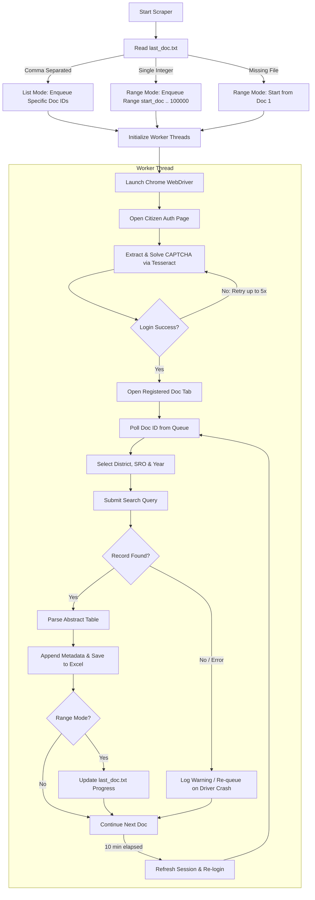

# Telangana Property Registration Document Scraper

An automated, multi-threaded Selenium scraper designed to extract registered document abstracts and property transaction details from the **Telangana Registration & Stamps Department Portal** (`registration.telangana.gov.in`).

The scraper includes automated CAPTCHA solving using **Pillow** and **Tesseract OCR**, resilient session management, automatic failure re-queuing, and thread-safe incremental exports to Excel.

---

## Table of Contents

- [Overview](#overview)
- [Workflow Architecture](#workflow-architecture)
- [Key Features](#key-features)
- [Prerequisites](#prerequisites)
- [Installation](#installation)
- [Configuration](#configuration)
- [Modes of Operation](#modes-of-operation)
- [Execution](#execution)
- [Output Data Schema](#output-data-schema)
- [Resilience & Error Handling](#resilience--error-handling)
- [Troubleshooting & FAQs](#troubleshooting--faqs)

---

## Overview

The scraper navigates the Telangana Citizen Portal, authenticates using citizen credentials, automatically solves dynamic alphanumeric image CAPTCHAs, queries property documents by year, district, and Sub-Registrar Office (SRO), extracts registration abstracts from web tables, and saves the records directly to an Excel spreadsheet.

### Target Portal
- **URL**: `https://registration.telangana.gov.in/citizen_auth.htm#!`
- **Department**: Registration & Stamps Department, Government of Telangana

---

## Workflow Architecture



---

## Key Features

1. **Multi-Threaded Architecture**:
   - Uses `threading.Thread` and thread-safe queues (`queue.Queue`) to run multiple browser workers simultaneously (`NUM_THREADS = 2`).
   - Staggered thread startup (2-second offset) prevents concurrent login collisions.

2. **Automated CAPTCHA Solving**:
   - Captures CAPTCHA session images directly with matching browser cookies via `requests.Session`.
   - Advanced image pre-processing pipeline via **Pillow**:
     - Grayscale conversion (`L`)
     - Autocontrast optimization
     - Binary thresholding (`lambda x: 0 if x < 150 else 255`)
     - Median filter noise reduction (`size=3`)
     - Lanczos 2x super-sampling
   - Character extraction powered by `pytesseract` with whitelist restriction (`A-Z0-9`) and PSM mode 7.

3. **Dual Execution Modes via `last_doc.txt`**:
   - **Range Mode**: Resumes scraping sequentially from a single specified document number up to `100,000`.
   - **List Mode**: Scrapes only explicit, comma-separated document IDs (e.g., `4911, 4912, 4915`).

4. **Thread-Safe Excel Persistence**:
   - Uses `threading.Lock` to guarantee safe concurrent writes to Excel (`openpyxl` with `mode='a'` and `if_sheet_exists='overlay'`).
   - Appends records immediately so data is never lost if execution is interrupted.

5. **Self-Healing Session Recovery**:
   - Proactive 10-minute session refreshment to avoid silent portal timeouts.
   - Automatically recovers from window closures or browser disconnects by launching a clean driver instance and re-inserting the failed document into the queue.

---

## Prerequisites

Before running the script, ensure you have the following installed:

1. **Python 3.8+**
2. **Google Chrome Browser** (Latest version recommended)
3. **ChromeDriver** (Managed automatically by modern Selenium 4)
4. **Tesseract OCR Engine**:
   - Download the installer for Windows from: [UB-Mannheim/tesseract/wiki](https://github.com/UB-Mannheim/tesseract/wiki)
   - Default install location: `C:\Program Files\Tesseract-OCR\tesseract.exe`

---

## Installation

1. **Clone the Repository**:
   ```bash
   git clone https://github.com/<your-username>/<your-repo-name>.git
   cd <your-repo-name>
   ```

2. **Set up a Virtual Environment (Optional but Recommended)**:
   ```bash
   python -m venv venv
   # On Windows (PowerShell)
   .\venv\Scripts\Activate.ps1
   # On Windows (CMD)
   .\venv\Scripts\activate.bat
   ```

3. **Install Required Python Dependencies**:
   ```bash
   pip install selenium pytesseract pillow pandas openpyxl requests
   ```

---

## Configuration

Open `Telangana_scrapper.py` and configure the following parameters to match your setup:

### 1. Tesseract OCR Path (Line 16)
Ensure this points to your Tesseract binary:
```python
pytesseract.pytesseract.tesseract_cmd = r"C:\Program Files\Tesseract-OCR\tesseract.exe"
```

### 2. Output and Progress Paths (Lines 18–19)
Specify your destination Excel file path and tracking file:
```python
excel_file = "registration_details_2025.xlsx"  # or custom path: r"C:\path\to\output.xlsx"
progress_file = "last_doc.txt"
```

### 3. Portal Credentials (Lines 110–112)
Provide your registered Citizen credentials for the Telangana portal:
```python
driver.find_element(By.ID, "username").send_keys("YOUR_USERNAME")
driver.find_element(By.ID, "password").send_keys("YOUR_PASSWORD")
```

### 4. District, SRO & Year Selection (Lines 148–160)
Adjust the target dropdown options and registration year according to your target jurisdiction:
```python
# District Option (e.g., option index 28)
district_option = wait.until(EC.element_to_be_clickable((By.XPATH, '//*[@id="districtCode"]/option[28]')))

# Sub-Registrar Office (SRO) Option (e.g., option index 5)
sro_option = wait.until(EC.element_to_be_clickable((By.XPATH, '//*[@id="sroCode"]/option[5]')))

# Registration Year
driver.find_element(By.ID, "regyear").send_keys("2025")
```

### 5. Concurrency (Line 25)
Control the number of parallel browser worker threads:
```python
NUM_THREADS = 2
```

---

## Modes of Operation

The scraper behavior is governed by the presence and content of `last_doc.txt` in the script's root directory:

| Mode | `last_doc.txt` Content | Behavior |
| :--- | :--- | :--- |
| **List Mode** | `4911, 4912, 4913, 5020` | Scrapes **only** the listed document numbers in order, then stops. `last_doc.txt` is **not** overwritten. |
| **Range Mode** | `4911` | Starts scraping sequentially from document `4911` up to `100,000`. Overwrites `last_doc.txt` after each successful document save to track progress. |
| **Fresh Start** | *(File does not exist)* | Begins sequential range scraping starting from document `1`. |

---

## Execution

Run the script from your terminal:

```bash
python Telangana_scrapper.py
```

### Terminal Output Indicators
- `🔁 [Worker-X] Login Attempt 1`: Initiating portal authentication.
- `🧠 [Worker-X] CAPTCHA: XXXXX`: OCR text result extracted from the CAPTCHA image.
- `✅ [Worker-X] Login successful`: Successfully entered citizen dashboard.
- `🔍 [Worker-X] Scraping Doc 4911`: Submitting search query for a specific document.
- `✅ [Worker-X] Doc 4911 saved`: Document data parsed and saved to Excel.
- `⚠️ Doc 4911: No data found`: Valid query, but no records exist on portal.
- `🔄 [Worker-X] Re-logging in due to timeout`: Triggered routine session refresh.

---

## Output Data Schema

Data is saved to the specified Excel file (`registration_details_2025.xlsx`). Each extracted record contains all abstract table columns from the portal along with appended metadata:

| Field Name | Description | Source |
| :--- | :--- | :--- |
| *Portal Abstract Headers* | Dynamic headers extracted directly from `#tabAbstract` (e.g., Sl No, Nature of Deed, Property Details, Parties, Market Value, Consideration Value). | Portal Web Table |
| `Document No` | The queried registration document number. | Query Parameter |
| `District` | The extracted name of the selected District. | Dropdown Label |
| `Sub-Registrar Office` | The extracted name of the Sub-Registrar Office (SRO). | Dropdown Label |

---

## Resilience & Error Handling

- **CAPTCHA Failures**: Retries up to 5 consecutive times per login cycle if the server responds with `"Invalid Captcha"`.
- **Session Expiry (10-Minute Timer)**: To prevent silent session invalidation, each worker automatically closes and re-authenticates every 600 seconds.
- **Window & Driver Crashes**: If an unexpected browser crash or `TimeoutException` occurs during scraping, the failed document is returned to the queue (`doc_queue.put(doc_no)`), the driver is restarted, and work resumes seamlessly.
- **Thread Safety**: Both Excel writes (`excel_lock`) and progress updates (`progress_lock`) are isolated with threading locks to prevent data corruption.

---

## Troubleshooting & FAQs

### 1. `TesseractNotFoundError`
- **Cause**: Python cannot find the `tesseract.exe` binary.
- **Fix**: Verify your installation path and update `pytesseract.pytesseract_cmd = r"C:\Program Files\Tesseract-OCR\tesseract.exe"` at line 16.

### 2. Login repeatedly fails with CAPTCHA errors
- **Cause**: Tesseract misread the noisy characters or portal layout changed.
- **Fix**: Check `captcha_Worker-X.png` generated in the script folder to see the saved image. Ensure Pillow and image filter thresholds match your screen resolution.

### 3. `PermissionError: [Errno 13] Permission denied: '...xlsx'`
- **Cause**: The output Excel file is currently open in Microsoft Excel or another viewer.
- **Fix**: Close Excel before running the scraper, as Windows locks open files against append operations.

### 4. Running in Headless Mode
- To run without opening visible browser windows, uncomment line 64 in `Telangana_scrapper.py`:
  ```python
  options.add_argument("--headless=new")
  ```

---

## Disclaimer

This tool is created for legitimate research, analytical, and data integration purposes. Ensure compliance with the Terms of Service of the respective government portals and adhere to responsible scraping practices (rate limiting, non-disruptive query frequencies).
